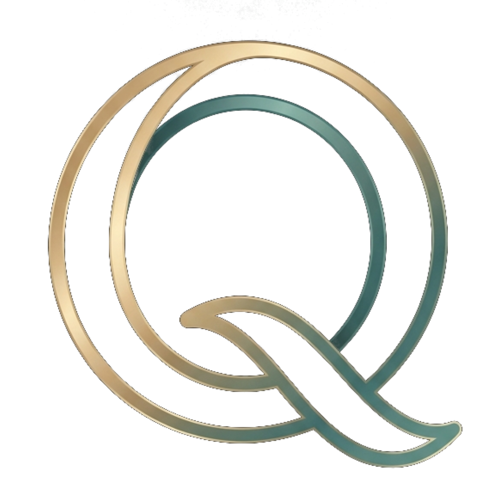

<div align="center">
  
  <h1>QBrowse</h1>
  <p><strong>Privacy-first desktop browser powered by a native Rust core.</strong><br/>Isolated spaces, built-in Tor with live circuit inspection, local multimodal AI, and zero-knowledge sync.</p>

  [](https://github.com/Qu-Bi/QBrowse/releases/tag/v1.5.1)
  [-orange.svg)](#powered-by-rust-napi-rs)
  [](#downloads)
  [](#windows-recommended)
  [](LICENSE)

  <p>
    <a href="#downloads">Downloads</a> •
    <a href="#what-makes-qbrowse-different">Features</a> •
    <a href="#powered-by-rust-napi-rs">Rust Core</a> •
    <a href="#building-from-source">Build from Source</a>
  </p>
</div>

---

QBrowse combines Chromium web compatibility with a high-performance, in-process **Rust (`napi-rs`) core** — keeping ad blocking, session isolation, local AI inference, credential encryption, and Tor control fast, lean, and strictly under your control.

---

## Downloads

Prebuilt installers and packages are available on the [GitHub Releases](https://github.com/Qu-Bi/QBrowse/releases) page.

### Windows (Recommended)

- **Web Installer (`QBrowse-Web-Setup.exe`)** — Tiny (~2–3 MB) custom native Rust installer with a dark glass UI, SHA-512 verification, and silent background setup.
- **Windows Package Manager (WinGet):**
  ```powershell
  winget install Qu-Bi.QBrowse
  ```
- **Offline Installer (`QBrowse-Setup-x64.exe`)** — Standalone NSIS installer with `.blockmap` delta update support.

### Linux

- **`.AppImage`** — Portable universal binary with atomic in-app self-updates.
- **`.deb`** — Debian, Ubuntu, Linux Mint, Pop!_OS.
- **`.rpm`** — Fedora, RHEL, openSUSE.
- **`.pacman`** — Arch Linux, Manjaro, EndeavourOS.
- **`.tar.gz`** — Portable archive.

---

## What Makes QBrowse Different

- **Spaces & Session Isolation** — Separate persistent cookie, cache, and storage partitions per workspace (`Personal`, `Work`, etc.), plus an ephemeral `Ghost` space and a `Tor` space that leave zero history or site permissions on disk.
- **Built-in Tor + Live 3-Hop Circuit Inspector** — Launches Tor on demand, visualizes live 3-hop circuits (Guard, Middle, Exit with country and IP), verifies SOCKS5h exit IP, and supports instant `NEWNYM` circuit rotation.
- **Native Rust Shield** — Network-layer ad and tracker blocking, third-party tracking cookie stripping, HTTPS-Only enforcement, cosmetic element collapsing, and per-site toggles.
- **Local AI via `llama.cpp`** — Runs GGUF models locally on CPU or GPU with Vision (`mmproj`), `Ctrl+V` image paste, PDF/DOCX/image OCR attachment parsing, voice input, and optional DuckDuckGo web context.
- **QVault + Windows Hello + Passkeys** — Encrypted local credential vault with master password, PIN lockout, Windows Hello biometric unlock, TOTP authenticator codes, WebAuthn passkeys, and CSV/JSON import from Bitwarden, Proton Pass, 1Password, Chrome, and Firefox.
- **Zero-Knowledge Cloud Sync** — Client-side AES-256-GCM encryption with PBKDF2 key derivation and Brotli payload compression before anything leaves your device.
- **Split/Quad View + Reader Mode + Smart Dark Mode** — Multi-pane side-by-side and quad browsing, distraction-free Reader Mode with Read Aloud highlighting, Smart Dark Mode, page highlighter & sticky notes, element eraser, and local PDF/media viewer.

---

## Powered by Rust (`napi-rs`)

Core browser subsystems run natively in Rust and bridge directly into Electron via `napi-rs` for lower memory overhead and faster startup:

| Crate | Responsibility |
| :--- | :--- |
| `qbrowse-storage` | SQLite + FTS5 full-text history, bookmarks, and workspace persistence |
| `qbrowse-shield` | Network ad/tracker filter engine, HTTPS-Only rules, and cosmetic filtering |
| `qbrowse-vault` | QVault AES-256-GCM credential encryption, TOTP, and importer parsing |
| `qbrowse-sync` | Zero-knowledge sync payload encryption, PBKDF2 key derivation, and Brotli compression |
| `qbrowse-reader` | Article extraction, HTML sanitization, and Reader Mode formatting |
| `qbrowse-media` | Local media streaming and range-request serving |
| `qbrowse-ai` | PDF/DOCX text extraction, OCR, and `llama.cpp` inference helpers |
| `qbrowse-tor` | Tor process lifecycle, control port, 3-hop circuit inspection, and `NEWNYM` rotation |
| `qbrowse-github` | GitHub Work Mode API integration and repository helpers |
| `qbrowse-sys` | OS-level helpers, Windows Hello integration, and system utilities |
| `qbrowse-installer` | Standalone native Rust web installer (`QBrowse-Web-Setup.exe`) with SHA-512 verification |

---

## Building from Source

### Prerequisites

- **Node.js** 20+ and `npm`
- **Rust toolchain** (`rustup` / `cargo` stable)
  - **Windows:** Visual Studio Build Tools (MSVC C++)
  - **Linux:** `build-essential` and `pkg-config`

### Run in Development

```bash
git clone https://github.com/Qu-Bi/QBrowse.git
cd QBrowse
npm install
npm run electron:start
```

### Package Installers

```bash
npm run build:installer  # Custom native Rust Web Installer (Windows)
npm run build:win        # Windows NSIS offline installer (.exe)
npm run build:linux      # Linux .AppImage, .deb, .rpm, .pacman, .tar.gz
```

---

## Code Signing & License

- **Code Signing:** Official Windows releases are signed with certificates from the [SignPath Foundation](https://signpath.org). See [CODE_SIGNING.md](CODE_SIGNING.md) for policy details.
- **License:** Distributed under the [MIT License](LICENSE).
