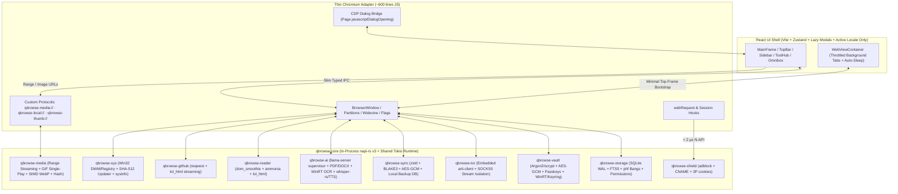

# QBrowse Rust Migration & Performance Audit

**Target Codebase:** QBrowse (`v1.4.3`)  
**Audit Goal:** Rebuild as much of QBrowse in Rust as possible to maximize speed, responsiveness, and memory efficiency **without breaking, removing, or degrading any existing feature**.

---

## 1. Executive Summary & Architectural Verdict

QBrowse is currently an Electron + React + Zustand desktop browser with a rich feature set: multi-space isolation (`personal`, `work`, `ghost`, `tor`, and custom spaces), split-screen & 2×2 quad-pane layouts, Liquid Glass UI overlays, QVault (passwords, TOTP, WebAuthn passkeys, Windows Hello / PIN), built-in Tor onion routing, Brave-powered adblocking + CNAME uncloaking, local Gemma/Qwen/Bielik AI via `llama.cpp`, Whisper STT / MMS-TTS, OCR/PDF/DOCX parsing, encrypted Firebase Cloud Sync, Reader Mode, Element Eraser, Webpage Highlighter + Sticky Notes, GitHub Work Mode, and custom local file/media/GIF wallpaper streaming.

Today, that logic is spread across:
- **Electron Main Process:** `electron/main.cjs` (**361.7 KB / 8,893 lines**) + 8 supporting `.cjs` engines (~260 KB total)
- **Webview Preload:** `electron/webview_preload.cjs` (**358.7 KB / 7,715 lines**)
- **Bundled Native Binaries:** `electron/bin/` (**~105 MB across 59 files**, including unused `llama.cpp` CLI/benchmark/quantization tools and `set-window-corners.exe`)
- **Renderer (`src/`):** **~5.5+ MB** of React/Zustand/i18n source, including **2.65 MB** of eagerly imported translation dictionaries (`src/i18n/domains/*.js`) and heavy WASM/PDF/Firebase vendor bundles.

### Critical Guardrail: Why NOT Rewrite Everything in Tauri / `wry` / OS WebViews

Although `vite.config.js` (lines 8–30) still contains leftover Tauri configuration comments, **replacing Electron's Chromium engine with Tauri (`wry` + OS WebViews: Edge WebView2, WebKitGTK, WKWebView) would break or severely degrade core QBrowse features**:

1. **Per-Space & Ephemeral Session Partitions (`src/components/layout/WebViewContainer.jsx:2169`, `electron/main.cjs:3805-3820`):** QBrowse relies on isolated `persist:profile_<id>`, in-memory `ghost`, and `tor` partitions with dynamic per-partition `socks5://127.0.0.1:<port>` proxies and `disable_non_proxied_udp` WebRTC policies. `WebKitGTK` and `WKWebView` lack equivalent dynamic per-tab proxy + cookie/storage partition controls.
2. **Sub-Resource Network Interception & Header Privacy (`electron/main.cjs:3078-3143`, `electron/adblockEngine.cjs`):** Chromium's `webRequest.onBeforeRequest`, `onBeforeSendHeaders`, and `onHeadersReceived` (sub-resource adblocking, 3rd-party cookie stripping, `sec-ch-ua` spoofing, DNT injection) do not exist uniformly across OS webviews in `wry`.
3. **Liquid Glass Z-Ordering & Backdrop Blur Over Web Pages (`WebViewContainer.jsx:2176-2350`, `2465-2471`, `MainFrame.jsx`):** `<webview>` renders inside Chromium's single GPU compositor tree, allowing CSS `backdrop-blur`, floating selection highlight pills, sticky notes, split-pane dividers, depth-focus scrims, and glass modals to composite cleanly *above* web content. Native child HWNDs in `wry` suffer from the OS "airspace" z-order limitation where native webview surfaces punch through HTML overlays.
4. **Widevine DRM (`electron/main.cjs:3946-3953` `components.whenReady()`), `qbrowse://flags` Chromium switches (`electron/main.cjs:1236-1295`), OAuth Popup Session Sharing (`electron/main.cjs:2305`), `capturePage()` thumbnails/snipping, and WebAuthn/Passkey Main-World Injection.**

### Recommended Target Architecture

| Architecture Option | Base Idle RAM | Startup Speed | Hot-Path Latency | Feature Parity | Verdict |
| :--- | :--- | :--- | :--- | :--- | :--- |
| **Current (Electron + Monolithic JS)** | High (Node + heavy V8 + unthrottled tabs + WASM) | Slow (4.5+ MB eager JS + sync disk/reg I/O) | Slowest (JS `webRequest`, Base64 IPC, `scryptSync`) | 100% (Baseline) | Current pain point |
| **Tier 1: Thin Chromium Shell + In-Process `napi-rs` Rust Core (Recommended)** | **40–65% lower** | **3–5× faster** | **`< 2 µs` native N-API** | **100% (Zero loss)** | **Best immediate path** |
| **Tier 2: Pure Rust Binary via `cef-rs` (Long-term)** | Lowest (eliminates Node.js ~60–80 MB) | Fastest | Native C++/Rust | High effort for OSR Liquid Glass compositing | Optional Phase 6+ |
| **Tauri / `wry` (OS WebViews)** | Low | Fast | Limited | **Breaks Tor partitions, `webRequest`, DRM, Glass z-order** | **Do NOT use** |

**Tier 1 Architecture:** Shrink `electron/*.cjs` by ~85% into a thin ~600-line Chromium window, session, and `WebContents` adapter, while moving **all** storage, networking/adblock/privacy logic, cryptography/QVault, Tor (`arti`), Cloud Sync crypto/compression, Local AI orchestration, PDF/DOCX/OCR/STT/TTS processing, media/GIF streaming, GitHub scraping, and Win32/Linux OS integration into a single compiled Rust native addon (`qbrowse-core.node` via `napi-rs` v3) backed by a shared `tokio` multi-threaded runtime and `rusqlite` (SQLite WAL + FTS5).

**Why In-Process `napi-rs` Beats a Localhost HTTP/WebSocket Rust Sidecar:**
- Synchronous network hot paths (`onBeforeRequest` / `onBeforeSendHeaders`) execute in **`< 2 µs`** via N-API instead of `0.5–2 ms` over localhost TCP/HTTP.
- Zero extra open local ports or auth-token plumbing.
- Zero-copy `Buffer` / `Uint8Array` views and single-process lifecycle (no orphaned sidecar processes).



---

## 2. Root-Cause Audit: Why QBrowse Feels Slow & Heavy Today

Before rewriting anything in Rust, it is critical to understand the **7 concrete bottlenecks** found in the current codebase:

### 2.1 Monolithic 358.7 KB `webview_preload.cjs` Injected Into Every Tab AND Every Sub-Frame
- **Where:** `electron/main.cjs:3450-3460` registers `webview_preload.cjs` via `sess.registerPreloadScript({ type: 'frame', filePath: preloadScriptPath })`, alongside `electron/main.cjs:2113`.
- **Size:** `electron/webview_preload.cjs` is **358,734 bytes (7,715 lines)** of unminified CommonJS bundling 10+ subsystems: Canvas Zoom, Reader detector, QVault Passkey WebAuthn polyfill, Media/PiP polling, Smart Dark luminance engine, Text Highlight + Accessibility CSS, Webpage Highlighter/Sticky Notes, QVault Inline Autofill, OAuth Popup Header DOM builder, YouTube Ad Mitigation, and Element Eraser.
- **Impact:** Because `type: 'frame'` is used, Chromium parses, compiles, and executes all 358 KB inside **every `<webview>` main frame AND every third-party ad, embed, and analytics `<iframe>`**, multiplying V8 heap usage and page-load latency.

### 2.2 Background Renderer Throttling & OS Occlusion Are Globally Disabled
- **Where:**
  - `electron/main.cjs:1187-1188`: disables `CalculateNativeWinOcclusion` and `UseEcoQoSForBackgroundProcess`.
  - `electron/main.cjs:1276-1279`: passes `--disable-renderer-backgrounding` and `--disable-backgrounding-occluded-windows` whenever `perfMode !== 'eco'`.
  - `electron/main.cjs:2123` & `2576`: explicitly calls `contents.setBackgroundThrottling(false)` on **every `<webview>`**.
- **Impact:** Every hidden background tab across `personal`, `work`, and custom spaces runs timers, `requestAnimationFrame`, React hydration, and background scripts at full foreground CPU/GPU priority indefinitely.

### 2.3 Tab Auto-Sleep Timeout Is Calculated But Never Scheduled
- **Where:** `electron/performanceEngine.cjs:100-107` computes `tabSleepTimeoutMinutes` (`5` min Eco, `15` min Balanced, `30` min Ultra), and `src/store/useTabStore.js:1031` implements `suspendTab()`.
- **Impact:** No background scheduler/timer anywhere in the app ever calls `suspendTab()` automatically for idle tabs, so closed-mental-model tabs keep full Chromium renderer processes alive in RAM forever.

### 2.4 4.5+ MB of Eagerly Parsed Renderer JS & All-Locale i18n Bloat on Startup
- **Where:**
  - `src/i18n/index.js:6-41` eagerly imports all 12 locales across 5 huge domain bundles (`tools.js` 891 KB, `settings.js` 670 KB, `chrome.js` 482 KB, `popovers.js` 444 KB, `stores.js` 166 KB = **2.65 MB of raw JS**) and constructs the full 12-language `DICTIONARIES` object synchronously before React mounts — even though only 1 language is active.
  - `src/App.jsx:21-40` and `src/components/layout/MainFrame.jsx:109-123` eagerly import massive hidden modals/popovers at startup instead of `React.lazy()`: `SettingsModal.jsx` (567 KB), `QVaultPopover.jsx` (205 KB), `ToolHub.jsx` (147 KB), `PresetStudioModal.jsx` (145 KB), `ContextMenuProvider.jsx` (141 KB), `TabMap.jsx` (141 KB), `SetupJourney.jsx` (134 KB), `UserProfilePopover.jsx` (112 KB), `ReaderModeOverlay.jsx` (48 KB), `TorCircuitPopover.jsx` (47 KB), plus `expandedBangsData.js` (137 KB).
  - `src/components/features/ToolHub.jsx:16-17` eagerly imports `whisperSTT.js` (`@xenova/transformers` / ONNX runtime) and `pdfjs-dist` at startup even if the user never opens ToolHub or uses voice input.

### 2.5 150 MB Base64 File IPC & Base64 Thumbnail State Bloat
- **Where:**
  - `electron/main.cjs:841-866` (`read-local-file-data`) reads PDFs and up to **150 MB** local video/audio/image files into Node RAM and Base64-encodes them (~200 MB string) over JSON IPC.
  - `src/components/pages/GlassDocumentViewer.jsx:99-110` runs `atob()` followed by a **single-threaded `for` loop (`bytes[i] = binary.charCodeAt(i)`)** over up to 150 million bytes on the React UI thread!
  - `src/components/layout/WebViewContainer.jsx:392-396` & `767-772` capture tab thumbnails as `data:image/png;base64,...` strings and store them directly inside Zustand `useTabStore` state.

### 2.6 Main-Thread Synchronous Disk I/O, Multi-`scryptSync` Stalls, `reg.exe` Polling & `localStorage` Thrashing
- **Where:**
  - `electron/main.cjs:203-211` (`getSettingsStore()`) calls `fsSync.readFileSync('settings.json')` + `JSON.parse` synchronously on every Smart Dark check/broadcast.
  - `electron/main.cjs:1516-1667` (`healAndDecryptVaultItems`) runs up to **7+ synchronous `crypto.scryptSync` derivations** on the Electron main thread, alongside `readVaultSync` / `writeVaultSync`.
  - `electron/main.cjs:1694` & `8383`: `checkWindowsReducedMotion()` can fall back to `execSync('reg.exe query ...')` polled on a `2500ms` `setInterval`.
  - `src/store/useHistoryStore.js:115`, `src/store/useTabStore.js:3126`, and `src/store/useUIStore.js` repeatedly `JSON.stringify` large state trees synchronously into `localStorage`.
  - `src/store/useSyncStore.js:141-158` runs 100k-iteration PBKDF2, giant `JSON.stringify`, and byte-by-byte `.map(b => b.toString(16))` hex encoding on the renderer UI thread.

### 2.7 Duplicate / Heavy Native & WASM Dependencies
- **Where:**
  - `electron/main.cjs:1062` unconditionally `require()`s `@ghostery/adblocker-electron` into memory even when `adblock-rs` is active.
  - `electron/adblockEngine.cjs:749-760` and `electron/main.cjs:2988-3008` call `webContents.fromId(details.webContentsId).getURL()` and `new URL()` 2–3 times on **every single network sub-resource request**.
  - `electron/bin/` ships 59 files (~105 MB) including unused benchmark/quantization CLIs (`llama-bench.exe`, `llama-perplexity.exe`, `llama-imatrix.exe`, `llama-quantize.exe`, etc.), and `electron/aiEngine.cjs:147-159` copies every file synchronously to `%APPDATA%\QBrowse\bin`.
  - `src/utils/whisperSTT.js` and `src/utils/localTTSWorker.js` load `@xenova/transformers` ONNX WASM pipelines in the renderer (~300–600 MB RAM), while `electron/main.cjs:7595-7620` loads `tesseract.js`, `pdf-parse`, and `mammoth` in Node.

---

## 3. Feature-by-Feature Rust Rebuild Audit (11 Rust Crates)

### 3.1 `qbrowse-shield` — Network Adblock, CNAME Uncloaking, 3rd-Party Cookie Stripper & Header Privacy
- **Current Implementation:** `electron/adblockEngine.cjs` (1,112 lines), `electron/darkModeWhitelist.cjs`, `electron/main.cjs:2850-3143` (`setupHeadersHandler`, `shouldStripThirdPartyCookies`, `RELATED_FIRST_PARTY_FAMILIES`), `src/utils/adblockUrlParser.js`, npm `@ghostery/adblocker-electron` & `adblock-rs`.
- **Current Bottleneck:** Every single sub-resource request crosses JS `webRequest` callbacks, performs multiple `new URL()` allocations, calls `webContents.fromId(id).getURL()` multiple times, and runs JS `Set`/string scans before hitting `adblock-rs`.
- **Rust Rebuild Design:**
  - Crates: `adblock` (Brave's Rust engine directly, removing JS wrapper overhead), `psl` / `addr` (PSL-accurate registrable domain matching), `hickory-resolver` (async CNAME uncloaking with DoH support + `moka` TTL cache), `reqwest` (parallel filter list updates), `memmap2` (zero-copy mmap of `engine-v4.bin`), `dashmap` (`DashMap<u32, TabContext>` tracking each `webContentsId`'s main-frame URL & space).
  - Expose a single fast N-API entrypoint: `evaluate_request(web_contents_id, url, referrer, initiator, resource_type, method) -> RequestDecision { cancel, strip_cookies, override_headers }` and `evaluate_response(...)`.
- **Zero-Regression Parity:** Preserves `YOUTUBE_PASS_THROUGH_DOMAINS`, `RELATED_FIRST_PARTY_FAMILIES` (Google, Librus, Microsoft, Allegro, gov.pl), OAuth/SSO bypasses, custom blocked domains, allowlists, GitHub raw/gist filter imports, cosmetic CSS/scriptlet injection, DNT, and `sec-ch-ua` Chrome UA spoofing.
- **Expected Gain:** `< 2 µs` per network decision; deletes `@ghostery/adblocker-electron` and `adblock-rs` npm wrapper overhead.

### 3.2 `qbrowse-vault` — QVault Password Manager, WebAuthn Passkey Enclave, TOTP & Native Biometrics
- **Current Implementation:** `electron/main.cjs:1354-1667` & `5600-6846`, `electron/verify_hello.ps1`, `src/utils/totp.js` (546 lines), `src/utils/vaultImporter.js`, `src/store/useVaultStore.js`.
- **Current Bottleneck:** Synchronous `vault.json` reads/writes, up to 7+ synchronous `scryptSync` calls on the main thread during `healAndDecryptVaultItems`, plaintext/private-key material crossing IPC into renderer JS, and spawning `powershell.exe` (`verify_hello.ps1`) taking ~1.2s for Windows Hello.
- **Rust Rebuild Design:**
  - Crates: `argon2` + `scrypt` (legacy migration), `aes-gcm`, `zeroize` (`Zeroizing<Vec<u8>>` wipes master keys and decrypted secrets from RAM on `vault-lock`), `p256` + `ed25519-dalek` + `ciborium` (hardware-isolated Rust WebAuthn passkey signing — **private keys never leave Rust**), `hmac` + `sha1` + `sha2` (RFC 6238 TOTP with Base32 mistype healing), `csv` + `serde_json` (Bitwarden, Proton Pass, 1Password, Chrome, QVault importers), `windows` (`UserConsentVerifier` + DPAPI `CryptProtectData`) + `keyring` (Linux SecretService / macOS Keychain).
- **Zero-Regression Parity:** Auto-migrates existing `vault.json` (including `title|||JSON` metadata unpacking and the parameter-swap self-healing logic at `main.cjs:1600-1629`) into encrypted SQLite columns; preserves PIN 5-attempt / 30s lockout, Ghost/Tor non-persistence, RP ID registrable-domain matching, and hardware YubiKey fallback.
- **Expected Gain:** Sub-millisecond unlock/search, zero `powershell.exe` spawn delay, memory-safe key zeroization.

### 3.3 `qbrowse-storage` — SQLite WAL + FTS5 Engine for History, Omnibox, Bangs, Permissions, Tabs & Bookmarks
- **Current Implementation:** `src/store/useHistoryStore.js`, `src/utils/historyExtractors.js` (947 lines), `src/utils/expandedBangsData.js` (137 KB), `src/utils/searchBangs.js`, `electron/permissionEngine.cjs` (850 lines), `electron/main.cjs:7407-7515` (Chrome/Edge/Brave/HTML bookmark importers), `localStorage` persistence in `useTabStore.js` & `useAnnotationStore.js`.
- **Current Bottleneck:** `localStorage` synchronous `JSON.stringify` on every navigation/tab change, history capped at 1,000 items, O(N) JS string scanning on every Omnibox keystroke, and 137 KB of bang definitions living permanently in V8 heap.
- **Rust Rebuild Design:**
  - Crates: `rusqlite` (`bundled` SQLite in WAL mode + FTS5 full-text search), `url`, `phf` (compile-time perfect hash map for all 1,000+ `!bang` / `@bang` triggers — **0 KB V8 heap, O(1) lookup**), `aho-corasick`, `lol_html` (streaming HTML bookmark parser).
- **Zero-Regression Parity:** One-time automatic import of existing `localStorage` history/tabs/pins/annotations + `site-permissions.json` + `settings.json`; strict Ghost/Tor/`.onion` zero-disk privacy enforced at the Rust type level (`SessionScope::Ephemeral` uses in-memory `DashMap` only, never touches SQLite); ports all intelligent title extractors (Google Maps places/directions, GitHub PRs/issues/commits, search queries, `stripTrackingParams`) to Rust.
- **Expected Gain:** History scales to 100,000+ entries with `< 1 ms` FTS5 omnibox autocomplete; removes `expandedBangsData.js` and history JSON from V8 heap.

### 3.4 `qbrowse-tor` — Embedded Memory-Safe Rust Tor Engine (`arti`)
- **Current Implementation:** `electron/torEngine.cjs` (769 lines), external `tor-expert-bundle.tar.gz` download, `tor.exe` + `curl.exe` subprocesses, unauthenticated `ControlPort 9051`.
- **Current Bottleneck:** Spawning/killing external `tor.exe` and `curl.exe` processes, fragile stdout regex bootstrap parsing, and downloading/chmodding external tarballs.
- **Rust Rebuild Design:**
  - Crates: `arti-client`, `tor-rtcompat`, `tokio` (in-process localhost SOCKS5 listener supporting SOCKS5 username/password **stream isolation per domain/tab**), `reqwest` (exit IP check directly over the `ArtiClient` circuit without spawning `curl.exe`).
- **Zero-Regression Parity:** Emits identical `tor-status-changed` and `tor-bootstrap-progress` events, real guard/middle/exit relay hop metadata for `TorCircuitPopover`, instant `NEWNYM` circuit isolation rotation, and `standard` / `safer` / `safest` security levels (with optional fallback to system `tor` binary only if custom pluggable-transport bridges are configured).
- **Expected Gain:** Eliminates external `tor.exe` & `curl.exe` processes, removes unauthenticated `ControlPort 9051`, and improves startup/circuit reliability.

### 3.5 `qbrowse-sync` — Compressed, Zero-Knowledge Encrypted Cloud Sync & Backup Engine
- **Current Implementation:** `src/store/useSyncStore.js` (211 KB / 4,481 lines) running WebCrypto PBKDF2, giant `JSON.stringify`, byte-by-byte hex encoding, and IndexedDB `qbrowse_backups_db` on the renderer UI thread.
- **Current Bottleneck:** Uncompressed JSON hex-encoded (2× size bloat) repeatedly hits Firestore's 1 MB document cap (`healBloatedRootDocument`), and encrypt/decrypt stalls the React UI thread.
- **Rust Rebuild Design:**
  - Crates: `zstd` (compresses backup JSON by 75–85% *before* encryption), `pbkdf2` / `argon2` + `aes-gcm` + `hex` / `base64` SIMD, `blake3` (instant state-hash deduplication so unchanged slices are skipped), `rusqlite` (local backup cache replacing IndexedDB), and optionally `reqwest` against Firebase Auth & Firestore REST APIs (allowing removal of the heavy `vendor-firebase` renderer chunk).
- **Zero-Regression Parity:** Decodes 100% of legacy `{ salt, iv, cipher }` hex payloads across all 11 nested schema variations (`extractEncryptedPayload` at `useSyncStore.js:166-219`), while writing v2 `zstd`+`AES-256-GCM` envelopes off the UI thread.
- **Expected Gain:** 75–85% smaller cloud payloads, zero UI frame drops during sync/backup.

### 3.6 `qbrowse-ai` — Local LLM Orchestrator, Native PDF/DOCX Parser, Native OCR & Native Whisper/TTS
- **Current Implementation:** `electron/aiEngine.cjs` (1,170 lines), `electron/main.cjs:7595-7662` (`ai-parse-file`, `ai-web-search`), `src/utils/whisperSTT.js`, `src/utils/localTTS.js`, `src/utils/localTTSWorker.js`, npm `tesseract.js`, `pdf-parse`, `mammoth`, `adm-zip`, `@xenova/transformers`.
- **Current Bottleneck:** `@xenova/transformers` loads ONNX WASM models in the renderer (~300–600 MB RAM); `tesseract.js` + `pdf-parse` + `mammoth` bloat Node; `electron/bin/` ships 59 files (~105 MB) and copies all of them synchronously on startup.
- **Rust Rebuild Design:**
  - **LLM Supervision:** Rust process supervisor for `llama-server` (with `reqwest` resumable parallel GGUF downloads + `zip`/`tar`/`flate2` extraction) or direct `llama-cpp-2` bindings. Prune `electron/bin/` to **only** `llama-server` + required `ggml`/`llama`/`mtmd` runtime DLLs (~80% size reduction).
  - **Document Parsing:** `pdf-extract` / `lopdf` (PDF -> text) + `zip` & `quick-xml` (`word/document.xml` DOCX -> text in `< 2 ms`).
  - **OCR:** `windows::Media::Ocr::OcrEngine` on Windows (built into Windows 10/11, 0 MB binary size, ~20× faster than `tesseract.js`) + `ocrs` pure-Rust fallback on Linux/macOS.
  - **Voice STT & TTS:** `whisper-rs` (reuses `ggml` libraries already shipped!) + `piper-rs` / native OS `tts` crate.
  - **Web Search RAG:** `reqwest` + `scraper` for `ai-web-search`.
- **Zero-Regression Parity:** Same IPC events (`ai-status-event`, `ai-log-event`, `ai-download-progress`, `ai-stream-token`, `ai-stream-done`), same GGUF model presets (Gemma 4, Qwen 3.5, Bielik 11B) and multimodal `mmproj` matching.
- **Expected Gain:** Saves **300–600 MB RAM** during voice/AI usage, shrinks `electron/bin/` by ~80%, and deletes `tesseract.js`, `pdf-parse`, `mammoth`, `adm-zip`, and `@xenova/transformers`.

### 3.7 `qbrowse-media` — Zero-Copy Protocol Streaming, GIF Loop Binary Engine, Directory Explorer & SIMD Image/Hash Pipeline
- **Current Implementation:** `electron/main.cjs:676-872` (`list-local-directory`, `autocomplete-local-path`, `read-local-file-data`), `3190-3380` (`verifyAndChecksumFile`), `4128-4202`, `8427-8872` (`parseGifBufferDuration`, `capture-and-save`), `src/utils/gifParser.js`, `src/components/pages/GlassDocumentViewer.jsx:99-110`, npm `sharp`.
- **Current Bottleneck:** Reading up to 150 MB local media/PDFs into Base64 strings over IPC and decoding them byte-by-byte with `atob()` on the UI thread; storing PNG Base64 tab thumbnails in Zustand; synchronous `sharp` dependency.
- **Rust Rebuild Design:**
  - Crates: `tokio::fs` + HTTP `206 Partial Content` byte-range streaming backing `qbrowse-local://`, `qbrowse-media://`, and `qbrowse-thumb://`; Rust binary GIF parser & `NETSCAPE2.0`/`ANIMEXTS1.0` single-play stripper (`qbrowse-media://gif-single/...`); `jwalk` / `ignore` for instant directory listing & path autocomplete; `blake3` + `sha2` streaming download verification; `image` + `fast_image_resize` (SIMD WebP thumbnails saved to disk cache) + `arboard` clipboard support.
- **Zero-Regression Parity:** Smooth crossfade/dip GIF wallpaper loops work identically without JS buffer cloning; Local Glass Explorer, PDF viewer, video/audio scrubbing, and SHA-256 download verification work seamlessly even on multi-GB files.
- **Expected Gain:** Eliminates 150–200 MB IPC memory spikes and UI-thread `atob()` freezes; deletes `sharp`.

### 3.8 `qbrowse-reader` — Native Readability Article Extractor & Sanitizer
- **Current Implementation:** `src/utils/readerExtractor.js` (`@mozilla/readability` + `DOMParser` double-parse on UI thread) + 4× `CHECK_ARTICLE_DOM_SCRIPT` polling timers in `WebViewContainer.jsx:659-668`.
- **Rust Rebuild Design:** `dom_smoothie` / `readability` + `ammonia` (XSS-safe HTML sanitizer) + `lol_html` (single-pass `data-tts-id="tts-block-N"` annotation, `loading="lazy"`, lead image extraction, word count, and reading time off the UI thread).
- **Zero-Regression Parity:** Produces the exact same `{ title, byline, siteName, domain, excerpt, leadImageUrl, publishedTime, wordCount, readingTimeMinutes, contentHtml, rawTextContent, ttsBlocks }` contract expected by `ReaderModeOverlay.jsx` and `ReadAloudPlayer.jsx`.
- **Expected Gain:** Zero UI-thread `DOMParser` jank on long articles.

### 3.9 `qbrowse-github` — Streaming GitHub Work Mode Engine
- **Current Implementation:** `electron/githubEngine.cjs` (1,076 lines) using `RegExp` loops and `JSON.parse` + recursive object walking on multi-MB GitHub HTML pages.
- **Rust Rebuild Design:** `reqwest` + `serde_json` + `lol_html` streaming HTML parser (`< 20 KB` memory footprint).
- **Zero-Regression Parity:** Preserves Token, Session-Cookie, and Public auth modes, repository/org filters, draft toggling, SSO/rate-limit error codes, and `powerMonitor` suspend/resume behavior.
- **Expected Gain:** Eliminates multi-MB HTML string allocations and regex backtracking.

### 3.10 `qbrowse-sys` — Direct Win32 / Linux / macOS System Integration, Default Browser & Auto-Updater
- **Current Implementation:** `electron/main.cjs` (`checkWindowsReducedMotion`, `applyWindowCornerPreference`, `registerWindowsBrowser`, `ensureLinuxDesktopEntry`, `checkIsDefaultBrowserAsync`, `updaterState`), `electron/linuxUpdateHelper.cjs`, `electron/bin/set-window-corners.exe`, npm `electron-updater`.
- **Current Bottleneck:** Spawning `set-window-corners.exe`, `reg.exe` (every 2.5s!), and `powershell.exe` child processes; heavy `electron-updater` dependency.
- **Rust Rebuild Design:**
  - Crates: `windows-sys` (`DwmSetWindowAttribute` for sharp/round/cohesive corners in `< 1 µs`; `SystemParametersInfoW` for reduced motion), `windows-registry` (direct Win32 registry reads/writes for Default Browser), `semver` + `serde_yaml` + `sha2` + `reqwest` (streaming SHA-512 verified GitHub Releases updater with atomic Linux AppImage replacement & `.deb`/`.rpm`/`pacman` detection), `sysinfo` (fast native process/RAM telemetry for `ResourceManagerModal`).
- **Zero-Regression Parity:** Exact same `updater-event` state shape and Windows/Linux/macOS default-browser behavior.
- **Expected Gain:** Deletes `set-window-corners.exe` and `electron-updater`; eliminates dozens of child-process spawns.

### 3.11 `qbrowse-dialog` — CSP-Safe Synchronous JS Dialog Bridge (Replacing `localDialogServer`)
- **Current Implementation:** `electron/main.cjs:347-467` runs an `http.createServer` on `127.0.0.1`, and `electron/main.cjs:3119-3140` rewrites every website's `Content-Security-Policy` `connect-src` header so guest pages can make synchronous XHR calls to `127.0.0.1` for `alert()` / `confirm()` / `prompt()`.
- **Rust + CDP Rebuild Design:** Intercept `alert()` / `confirm()` / `prompt()` natively via Chromium DevTools Protocol (`webContents.debugger`: `Page.enable` -> `Page.javascriptDialogOpening` + `Page.handleJavaScriptDialog`) coordinated with Rust dialog state and `BrowserDialogOverlay.jsx`.
- **Zero-Regression Parity:** Keeps the exact same Liquid Glass in-tab `BrowserDialogOverlay` UI while Chromium natively pauses the guest JS execution context — **without opening a local HTTP port, without synchronous XHR hacks, and without weakening any website's CSP headers**.

### Master Summary Table

| Rust Module | Replaces | Key Crates | Est. RAM Saved | Latency / Speed Gain | Regression Risk |
| :--- | :--- | :--- | :--- | :--- | :--- |
| `qbrowse-shield` | `adblockEngine.cjs`, `main.cjs` `webRequest`, `@ghostery/*`, `adblock-rs` | `adblock`, `hickory-resolver`, `dashmap`, `memmap2`, `psl` | ~40–70 MB | `< 2 µs` / request | **None** |
| `qbrowse-vault` | `main.cjs` Vault/Passkeys, `verify_hello.ps1`, `totp.js`, `vaultImporter.js` | `argon2`, `scrypt`, `aes-gcm`, `zeroize`, `p256`, `windows` | ~15–25 MB | 1.2s Hello -> `< 20 ms` | **None** (auto-migrates `vault.json`) |
| `qbrowse-storage` | `useHistoryStore.js`, `expandedBangsData.js`, `permissionEngine.cjs`, bookmark import | `rusqlite` (WAL+FTS5), `phf`, `lol_html`, `url` | ~30–50 MB | `< 1 ms` omnibox FTS5 | **None** (one-time import) |
| `qbrowse-tor` | `torEngine.cjs`, `tor.exe`, `curl.exe` | `arti-client`, `tor-rtcompat`, `tokio`, `reqwest` | ~25–45 MB | Faster circuit init + isolation | **None** |
| `qbrowse-sync` | `useSyncStore.js` crypto/compression/IDB | `zstd`, `pbkdf2`, `aes-gcm`, `blake3`, `rusqlite` | ~20–40 MB | 75–85% smaller sync payloads | **None** (reads v1 hex) |
| `qbrowse-ai` | `aiEngine.cjs`, `whisperSTT.js`, `localTTS*`, `tesseract.js`, `pdf-parse`, `mammoth` | `pdf-extract`, `quick-xml`, `windows::Media::Ocr`, `ocrs`, `whisper-rs` | **300–600 MB** | 10–20× faster OCR/PDF/STT | **None** |
| `qbrowse-media` | `read-local-file-data`, `gifParser.js`, `sharp`, checksums | `tokio::fs`, `image`, `fast_image_resize`, `jwalk`, `blake3`, `sha2` | **150–300 MB** | Instant streaming (`206`) | **None** |
| `qbrowse-reader` | `readerExtractor.js`, `CHECK_ARTICLE_DOM_SCRIPT` polling | `dom_smoothie`, `ammonia`, `lol_html` | ~15–25 MB | Off-UI-thread extraction | **None** |
| `qbrowse-github` | `githubEngine.cjs` | `reqwest`, `lol_html`, `serde_json` | ~10–20 MB | Streaming HTML parse | **None** |
| `qbrowse-sys` | Win32 `reg.exe`/`set-window-corners.exe`, `electron-updater`, `sysinfo` | `windows-sys`, `windows-registry`, `semver`, `sysinfo` | ~15–25 MB | `< 1 µs` DWM/Registry | **None** |
| `qbrowse-dialog` | `localDialogServer` + CSP `connect-src` mutation | Rust state + Chromium CDP `Page.javascriptDialogOpening` | ~5 MB | Native pause, CSP-safe | **None** |

---

## 4. Mandatory Electron & React Fixes (Must Pair With Rust)

Rebuilding the backend in Rust alone will **not** fix Chromium's tab RAM or React's startup parse cost unless paired with these 5 zero-feature-loss fixes:

1. **Refactor `electron/webview_preload.cjs` (358.7 KB -> ~12 KB Top-Frame Bootstrap + On-Demand Injection):**
   - Stop registering the full 358 KB script with `{ type: 'frame' }` (`main.cjs:3453`) so third-party ad/embed iframes stop compiling 7,715 lines of JS.
   - Bundle/minify with `esbuild` and split OAuth Popup UI, Element Eraser, Webpage Highlighter, and Passkey Main-World injection into separate cached scripts injected only when activated or on top frames.
2. **Re-Enable Smart Background Throttling & Wire Up Automatic Tab Suspension:**
   - Remove global `--disable-renderer-backgrounding`, `--disable-backgrounding-occluded-windows`, and unconditional `setBackgroundThrottling(false)` (`main.cjs:1277-1278, 2576`).
   - Throttle hidden `<webview>`s (`setBackgroundThrottling(true)`), dynamically unthrottling **only** active tab(s)/split-panes and tabs emitting `media-started-playing` / PiP.
   - Add a 60s scheduler enforcing `tabSleepTimeoutMinutes` (`5m` Eco / `15m` Balanced / `30m` Ultra) to auto-call `suspendTab()`, saving **80–250 MB RAM per idle tab**.
3. **Lazy-Load Translations (`src/i18n/index.js`) & Heavy Modals (`src/App.jsx`, `MainFrame.jsx`):**
   - Split `src/i18n/domains/*.js` (2.65 MB) into per-locale JSON/chunks (or serve from Rust `qbrowse-core`), loading **only the active language** (~220 KB).
   - Wrap `SettingsModal`, `QVaultPopover`, `ToolHub`, `PresetStudioModal`, `TabMap`, `SetupJourney`, `UserProfilePopover`, `ReaderModeOverlay`, `TorCircuitPopover`, `CookiesModal`, `HistoryModal`, `ResourceManagerModal`, and `LivingTour` in `React.lazy()` + `<Suspense>`.
4. **Replace Base64 Thumbnails & Base64 Local File Payloads With Custom Protocol URLs:**
   - Store `qbrowse-thumb://tab/<id>?v=<ts>` strings in `useTabStore` instead of PNG Base64 data URLs.
   - Stream PDFs, videos, audio, and images in `GlassDocumentViewer` / `GlassPdfViewer` via `qbrowse-local://` HTTP Range requests instead of `read-local-file-data` Base64 + `atob()`.
5. **Keep `<webview>` (For Now) Over `WebContentsView`:**
   - Keeping `<webview>` with smart throttling + auto-sleep preserves Liquid Glass popover z-ordering, 2×2 quad split animations, and CSS blur scrims with zero compositor regressions. A future `WebContentsView` split-compositor can be evaluated later if needed.

---

## 5. Proposed Cargo Workspace & Phased Zero-Downtime Migration Plan

### 5.1 Cargo Workspace Layout
`package.json` already configures `"asarUnpack": ["**/*.node"]` (`package.json:147-149`), so `electron-builder` will natively unpack the compiled Rust `.node` addon on Windows and Linux.

```text
QBrowse/
├── rust/
│   ├── Cargo.toml                  # Workspace root (resolver = "2", lto = "thin", strip = true)
│   └── crates/
│       ├── qbrowse-napi/           # napi-rs v3 cdylib -> electron/native/qbrowse_core.<platform>.node
│       ├── qbrowse-shield/         # adblock + hickory-resolver + cookie/header rules
│       ├── qbrowse-vault/          # Argon2/scrypt + AES-GCM + zeroize + WebAuthn + WinRT/Keyring
│       ├── qbrowse-storage/        # SQLite WAL + FTS5 + phf bangs + permissions + bookmarks
│       ├── qbrowse-tor/            # arti-client + tokio SOCKS5 stream isolation
│       ├── qbrowse-sync/           # zstd + BLAKE3 + AES-GCM + local backup SQLite
│       ├── qbrowse-ai/             # llama-server supervisor + PDF/DOCX + OCR + whisper-rs/TTS
│       ├── qbrowse-media/          # Range streaming + GIF single-play + SIMD WebP + hashes
│       ├── qbrowse-reader/         # dom_smoothie + ammonia + lol_html
│       ├── qbrowse-github/         # reqwest + lol_html streaming scraper
│       └── qbrowse-sys/            # Win32 DWM/Registry + SHA-512 updater + sysinfo
├── electron/
│   └── main.cjs                    # Slimmed to ~600-line Chromium/IPC/Protocol adapter
└── src/                            # Lazy-loaded React UI + single-locale i18n
```

### 5.2 5-Phase Zero-Downtime Migration Roadmap

1. **Phase 1 — Renderer & Electron Diet + `qbrowse-napi` Scaffold (Fastest Immediate Win):**
   - Split/minify `webview_preload.cjs` (remove `{ type: 'frame' }` subframe bloat), re-enable smart background throttling + auto-tab-sleep scheduler, lazy-load 2.65 MB i18n + heavy modals, migrate `localDialogServer` to CDP `Page.javascriptDialogOpening`, prune unused CLIs in `electron/bin/`, and wire `@napi-rs/cli` in `rust/` + `.github/workflows/release.yml`.
   - *Verify:* Cold start, tab switching, OAuth popups, `alert/confirm/prompt`, and `npm run build` all pass.
2. **Phase 2 — `qbrowse-storage` + `qbrowse-media` + `qbrowse-sys`:**
   - Enable SQLite WAL + FTS5 (auto-importing `localStorage`, `site-permissions.json`, `settings.json`), `phf` bangs, `qbrowse-local://` + `qbrowse-thumb://` streaming, Rust GIF single-play engine, and Win32 DWM/Registry/Updater. Delete `sharp`, `electron-updater`, and `set-window-corners.exe`.
   - *Verify:* Existing user history/tabs/permissions/settings migrate cleanly; 100 MB+ local video & PDFs open instantaneously; GIF crossfade/dip wallpapers and auto-updater work.
3. **Phase 3 — `qbrowse-shield` + `qbrowse-reader` + `qbrowse-github`:**
   - Replace `adblockEngine.cjs` and `main.cjs` `webRequest` handlers with `qbrowse-shield`, `readerExtractor.js` with `qbrowse-reader`, and `githubEngine.cjs` with `qbrowse-github`. Delete `@ghostery/adblocker-electron` and `adblock-rs`.
   - *Verify:* YouTube playback + ad mitigation, Google/Librus/OAuth logins, CNAME uncloaking, Reader Mode + TTS, and GitHub Work Mode all pass.
4. **Phase 4 — `qbrowse-vault` + `qbrowse-sync`:**
   - Move QVault encryption, `vault.json` self-healing migration, WebAuthn signing, TOTP, Windows Hello WinRT / Linux Keyring, and `zstd` Cloud Sync crypto/backups into Rust. Delete `verify_hello.ps1`.
   - *Verify:* Master password, PIN lockout, Windows Hello, passkey sign-in, and legacy Cloud Sync restore all pass.
5. **Phase 5 — `qbrowse-tor` + `qbrowse-ai`:**
   - Swap `torEngine.cjs` for embedded `arti` (`qbrowse-tor`) and replace `tesseract.js`, `pdf-parse`, `mammoth`, `adm-zip`, and `@xenova/transformers` with `qbrowse-ai` native PDF/DOCX/OCR/`whisper-rs`/TTS.
   - *Verify:* `.onion` routing, Tor circuit HUD, `NEWNYM`, GGUF chat, PDF/DOCX/image OCR attachment, and voice STT/TTS all pass.

### 5.3 Expected "Before vs After" Resource Footprint

| Metric | Current (Electron + JS) | After Full Migration (Tier 1) |
| :--- | :--- | :--- |
| **Cold Startup Time** | ~2.5–4.5 s | **~0.5–1.0 s** |
| **Base Idle RAM (1–2 tabs)** | ~450–700 MB | **~220–320 MB** |
| **15-Tab Multi-Space RAM** | ~2.2–3.8 GB | **~750 MB–1.3 GB** (throttling + auto-sleep) |
| **Voice / OCR / AI Overhead** | +350–650 MB (WASM + Node) | **+40–120 MB** (native `whisper-rs` / WinRT OCR) |
| **Network Filter Latency** | ~80–400 µs (JS + IPC + `fromId`) | **`< 2 µs`** (in-process Rust N-API) |
| **Packaged App Footprint** | ~105 MB `electron/bin/` + heavy `node_modules` | **~70–85 MB smaller** (pruned `bin/`, deleted WASM/JS deps) |
